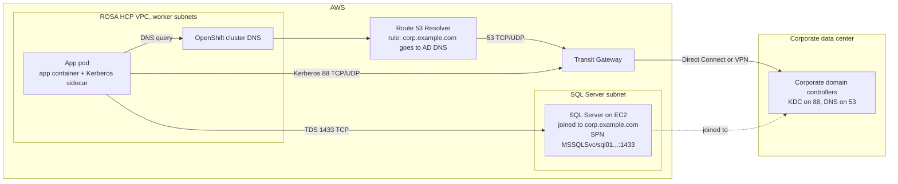
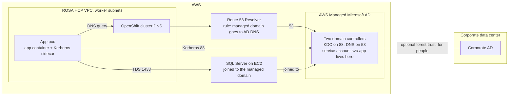
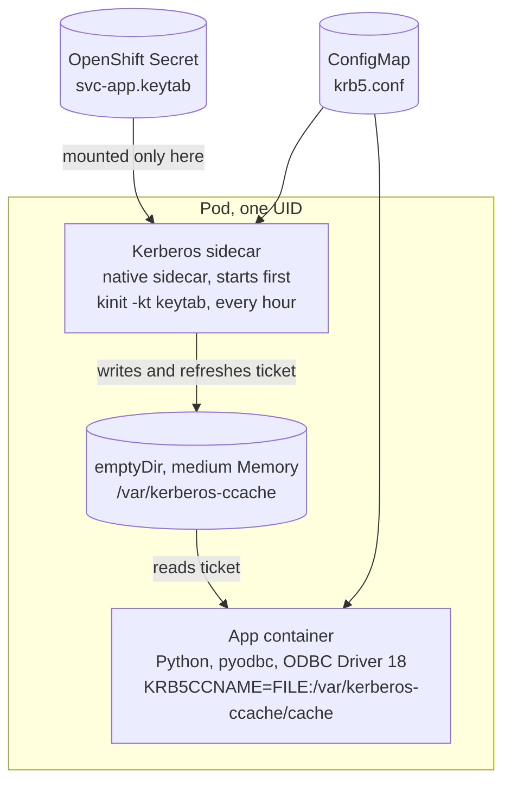
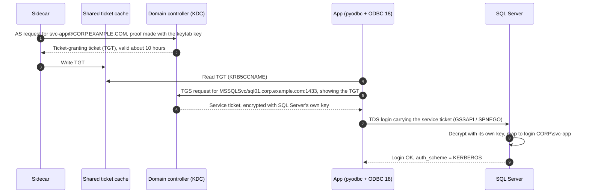
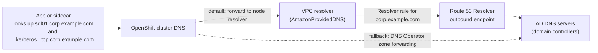
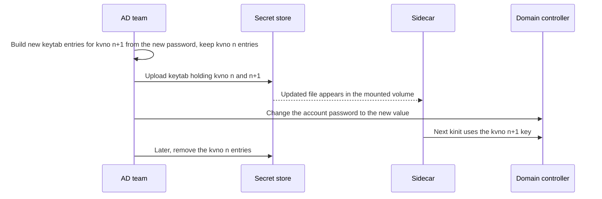

# Architecture

All diagrams are Mermaid and render in VS Code (with a Mermaid extension), GitHub, GitLab and Obsidian. Names are placeholders:

| Placeholder | Meaning |
| --- | --- |
| `corp.example.com` | AD domain (DNS name) |
| `CORP.EXAMPLE.COM` | Kerberos realm, the same name in upper case |
| `CORP\svc-app` | The app's AD service account |
| `sql01.corp.example.com` | SQL Server on EC2 |
| `MSSQLSvc/sql01.corp.example.com:1433` | SQL Server's SPN |

## 1. Big picture, variant A: corporate AD

SQL Server on EC2 is joined to the existing corporate domain. The domain controllers sit in the corporate data center, or in AWS as part of the corporate domain. Either way, ROSA reaches them through the corporate network path.

What changes in this variant: the corporate AD team owns the service account, the keytab and the SPN. Kerberos traffic crosses Direct Connect or VPN, so that link going down stops new logins. Connections that are already open keep working.

## 2. Big picture, variant B: AWS Managed Microsoft AD

SQL Server on EC2 is joined to an AWS Managed Microsoft AD domain. A trust to corporate AD is optional; people use it to log in with corporate accounts. The app does not need it, because its service account lives in the managed domain next to SQL Server.

What changes in this variant: the domain controllers are in AWS, so the Kerberos path is short and does not depend on Direct Connect. AWS delegates an OU where your admins can create the service account and SPNs. The network path between the ROSA VPC and the managed AD VPC still needs routing (peering or Transit Gateway) and security group rules.

## 3. Inside the pod

Both containers run with the same user ID, because MIT Kerberos creates the ticket file readable by its owner only (mode 0600).

Order of events:

1. The sidecar starts first, because it is a native sidecar: an init container with `restartPolicy: Always`. It runs `kinit`, and its startup probe (`klist -s`) passes once a ticket exists. If `kinit` keeps failing, the app never starts, which makes a broken keytab or a network problem obvious.
2. The app container starts, reads the ticket through `KRB5CCNAME`, and opens connections with `Trusted_Connection=yes`.
3. The sidecar refreshes the ticket every hour. AD issues user tickets for 10 hours by default, so an hourly refresh leaves a wide margin.
4. When the app exits, as a Job or an Airflow task does, Kubernetes stops the sidecar too and the pod can finish.

Fallback if the cluster does not support native sidecars (they are stable from Kubernetes 1.33; ask the platform team which version runs): an ordinary init container runs `kinit` once before the app starts, and the sidecar becomes an ordinary second container. That works for apps that run all day. A pod that should finish stays `Running`, because the ordinary sidecar never exits.

## 4. What happens during a login

Steps 1 and 2 need the keytab and port 88. Steps 5 and 6 need the SPN to exist exactly once in AD. Step 7 is the only traffic that goes to SQL Server. In step 8 SQL Server checks the ticket with its own key and does not need the KDC to accept it, which is why the SPN and SQL Server's own account have to match. (It may still contact a domain controller to validate the ticket's group data or look up group membership.)

## 5. How a pod resolves AD names

The solid path needs no change inside the cluster; the network team adds a Resolver rule and associates it with the ROSA VPC. Many companies already share such rules across accounts, so check first. The dotted path is the OpenShift DNS Operator forwarding a named zone straight to the AD DNS servers. ROSA documents it. Red Hat's managed-cluster configuration grants the `dedicated-admin` role patch rights on `dns.operator/default` for HCP clusters too, but confirm this on your cluster during the PoC.

## 6. Keytab rotation

The keytab holds a key derived from the account password. When the password changes, AD increases the key version number (kvno) and the old keytab stops working. The safe order:

Doing it in a different order (password first, keytab later) leaves a window where `kinit` fails. Microsoft documents this order for SQL Server's own keytab on Linux ([Rotate SQL Server on Linux keytabs](https://learn.microsoft.com/en-us/sql/linux/security/authentication/rotate-keytabs)). The same logic applies to a client keytab. Mounted Secrets update in place, but not when mounted with `subPath`.

The alternative is an AD policy exception so the service account's password never expires, with the keytab rotated by hand on a schedule. The security team decides.

## 7. Network flows

Source for every row: the ROSA worker subnet CIDRs, or the EgressIP addresses if EgressIP is used.

| Destination | Port | Protocol | Needed for | Required |
| --- | --- | --- | --- | --- |
| Domain controllers (KDC) | 88 | TCP and UDP | Getting tickets | Yes |
| AD DNS servers, or the Route 53 Resolver endpoint | 53 | TCP and UDP | Resolving the SQL Server name and KDC SRV records | Yes |
| SQL Server EC2 | 1433 (or its static port) | TCP | The database connection | Yes |
| SQL Server EC2 | 1434 | UDP | SQL Browser, only for a named instance with no port in the connection string | Avoid; use a static port |
| Domain controllers | 464 | TCP and UDP | Password changes, only if a tool in the cluster rotates the password | No |
| Domain controllers | 389 / 636 | TCP | LDAP, only for tools such as `adutil` or `msktutil` | No |

Port 88 should allow TCP. AD tickets carry group membership data and often exceed the UDP size limit, and `udp_preference_limit = 0` in `krb5.conf` makes the client use TCP from the start.
