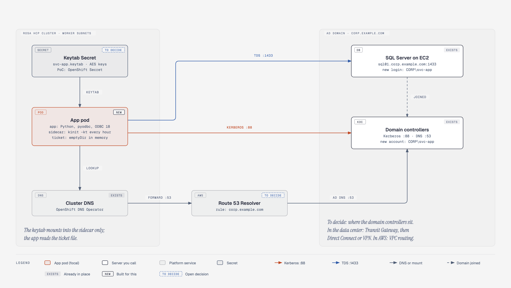
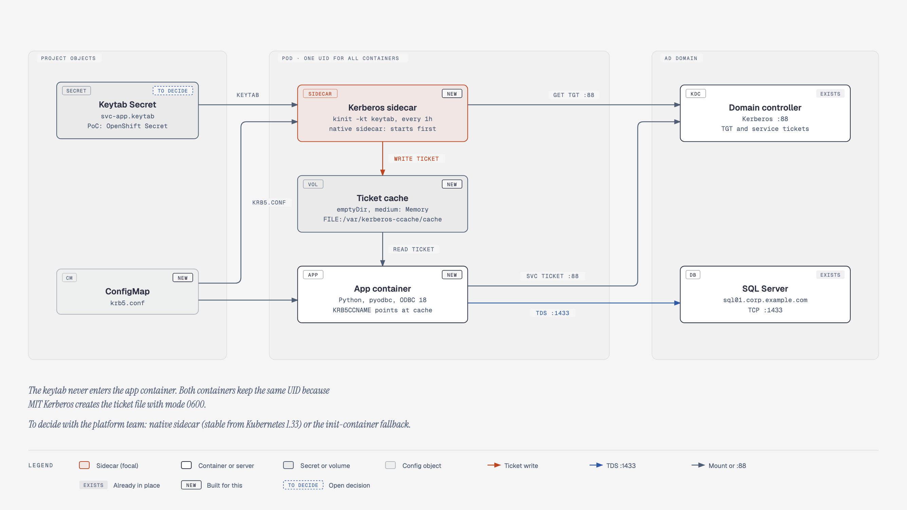

# Windows Authentication from Linux containers to SQL Server: pre-read

For the container platform team, ahead of a 30-minute discussion.

## Why I am asking

A Python app, and later Airflow, running in a Linux container on our ROSA HCP cluster needs to log in to SQL Server with Windows Authentication, as an AD service account. Before building anything, I want to know whether a team here already does this, so I can follow the pattern we already have. The design below is where my research points so far. Nothing in it is decided yet, so treat it as a draft to react to.

## Constraints

- The client is Python with pyodbc and Microsoft ODBC Driver 18 for SQL Server, on Linux.
- SQL Server runs on EC2 and is already joined to our AD domain. AD and SQL Server already exist; only an account, a login and access rules would be added.
- On Linux, the ODBC driver supports Windows Authentication only through Kerberos. It has no NTLM mode.
- ROSA cannot run Windows containers, so a gMSA (group Managed Service Account) is not an option.
- Nothing can be installed on ROSA nodes, so everything Kerberos needs has to come with the pod.

## Draft design

One AD service account, `CORP\svc-app`, with a keytab: a file that holds the account's Kerberos keys and works like a password. A small helper container in the same pod, the Kerberos sidecar, uses the keytab to get a fresh Kerberos ticket every hour and writes it to an in-memory folder shared with the app. The app connects with `Trusted_Connection=yes` and never sees the keytab. Red Hat published this sidecar pattern in 2018 for the same ODBC driver, and the Airflow Helm chart uses the same model.





## What exists, what is new, what is open

| Item | Status | Owner |
| --- | --- | --- |
| AD domain controllers | Exists | AD team |
| SQL Server on EC2 | Exists. Check its SPN, fixed port and TLS certificate | DBA |
| ROSA HCP cluster and cluster DNS | Exists | Platform team |
| AD service account `CORP\svc-app` and its AES keytab | New | AD team |
| SQL Server login for `CORP\svc-app` | New | DBA |
| Pod: app container, Kerberos sidecar, ConfigMap, in-memory volume | New, PoC only | Me |
| Where the keytab is stored: OpenShift Secret, AWS Secrets Manager CSI, External Secrets Operator or Vault | To decide | Platform and security teams |
| How pods resolve AD names: Route 53 Resolver rule or DNS Operator forwarding | To decide | Platform and network teams |
| Network path from the worker subnets to the domain controllers (port 88) and SQL Server (port 1433) | To decide | Network team |
| Native sidecar, or the init-container fallback for older clusters | To decide | Platform team |

## Questions for the platform team

1. Does any workload on our clusters already use AD or Kerberos: SQL Server, file shares, Kafka, or web services with Windows login? Which team owns it, and can I see its manifests?
2. Is there an approved base image, sidecar image or Helm chart that includes `krb5-workstation` or `msodbcsql18`?
3. Where do teams keep binary secrets such as keytabs? Is there a rule against keytabs in the cluster?
4. Can pods resolve corporate names today? A quick test from any pod: `getent hosts <a-domain-controller-fqdn>`.
5. Is traffic from the worker subnets to the domain controllers (port 88) and SQL Server (port 1433) already allowed? Do we use EgressIP?
6. Which OpenShift version runs on the cluster? Native sidecars are stable from Kubernetes 1.33.
7. Is Windows Authentication required by policy here, or is there a standard for containers already, such as SQL logins with passwords from a vault?

## What I am checking with other teams

The existing solution may sit outside the platform team, so I am also asking:

- The DBA team, to run this on SQL Server a few times. A pod-like `host_name` with `client_interface_name` of ODBC or JDBC means someone already connects from containers with Kerberos. It needs `VIEW SERVER STATE` and shows current sessions only.

```sql
SELECT s.login_name, s.host_name, s.program_name, s.client_interface_name,
       c.client_net_address, c.auth_scheme
FROM sys.dm_exec_sessions s
JOIN sys.dm_exec_connections c ON c.session_id = s.session_id
WHERE c.auth_scheme = 'KERBEROS';
```

- The AD team: have they issued keytabs before, for which systems, and do they require AES?
- Our Git server, searched for `krb5.conf`, `KRB5CCNAME`, `kinit -kt`, `keytab`, `Trusted_Connection=yes`, `integratedSecurity=true`, `JavaKerberos` and `airflow kerberos`.
- Data platform teams running Airflow, Spark or ETL tools on Linux, which often used keytabs in the Hadoop era.

## What I would like from the meeting

- A pointer to an existing pattern to follow, or agreement to run a PoC with this design in a test project.
- An owner for each open decision in the table above.
- A contact for the cluster's DNS and egress settings.

## More detail

The full research pack has the options compared (`01-feasibility-and-options.md`), the architecture for both AD setups (`02-architecture.md`), the checklist by team (`03-prerequisites-checklist.md`), the PoC test plan (`04-poc-test-plan.md`), and beginner explainers in `learn/`. I can share any of it.
