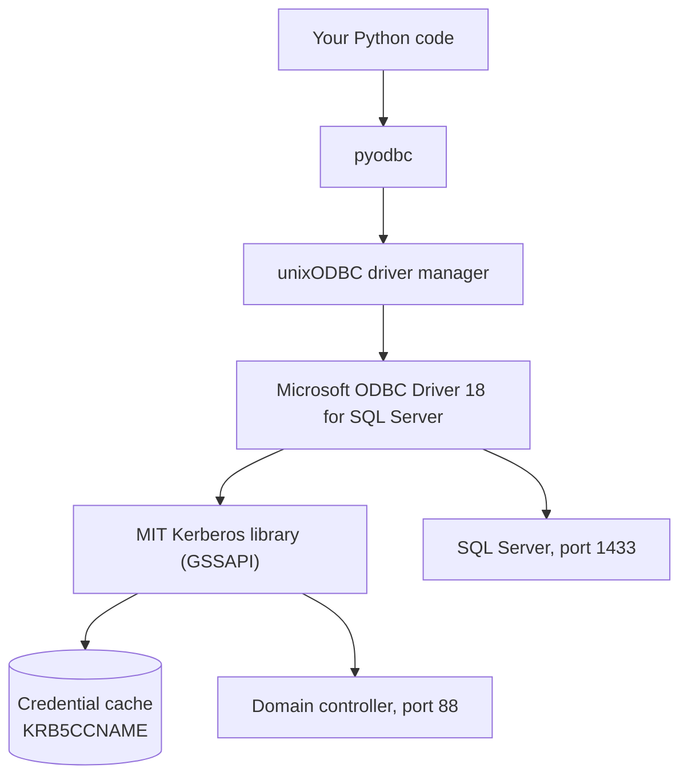

# SQL Server logins and the ODBC driver

This page covers the SQL Server side (the login) and the client side (pyodbc and Microsoft ODBC Driver 18): what each piece does and how to check that Kerberos was really used.

## The login on SQL Server

SQL Server needs a login for the AD account, plus a user in each database the app touches:

```sql
CREATE LOGIN [CORP\svc-app] FROM WINDOWS;
USE AppDb;
CREATE USER [CORP\svc-app] FOR LOGIN [CORP\svc-app];
-- then grant only the roles or permissions the app needs
```

The name uses the `DOMAIN\account` form; `account@domain` is not accepted ([CREATE LOGIN](https://learn.microsoft.com/en-us/sql/t-sql/statements/create-login-transact-sql)). A login can also be created for an AD group, so that every member can connect. For a single app account, a direct login is clearer.

Without this login, Kerberos succeeds and SQL Server still refuses the connection with `Login failed for user 'CORP\svc-app'`. That message is good news during a PoC: it means the Kerberos part worked.

## The client stack



pyodbc passes the connection string to the driver unchanged ([pyodbc wiki](https://github.com/mkleehammer/pyodbc/wiki/The-pyodbc-Module)). The ODBC driver asks the Kerberos library for a service ticket. The library reads the TGT from the credential cache, contacts the KDC, and hands the ticket back to the driver, which sends it to SQL Server.

## The connection string

```text
Driver={ODBC Driver 18 for SQL Server};
Server=sql01.corp.example.com,1433;
Database=AppDb;
Trusted_Connection=yes;
Encrypt=yes;
```

What each keyword means for Kerberos ([Microsoft: Use Integrated Authentication](https://learn.microsoft.com/en-us/sql/connect/odbc/linux-mac/using-integrated-authentication), [Microsoft: Connection string keywords](https://learn.microsoft.com/en-us/sql/connect/odbc/dsn-connection-string-attribute)):

- `Trusted_Connection=yes` selects integrated (Kerberos) authentication. Leave out `UID` and `PWD`, and do not add an `Authentication=` keyword.
- `Server` must be the fully qualified name that appears in the SPN. The driver builds the SPN `MSSQLSvc/<server>:<port>` from it. An IP address or an alias produces an SPN that does not exist.
- `ServerSPN=MSSQLSvc/sql01.corp.example.com:1433` overrides the SPN the driver builds. Use it when you must connect through a different name, for example a load balancer or a test alias.
- `Encrypt=yes` is the default in Driver 18, and the driver validates the server's TLS certificate. If SQL Server presents a self-signed certificate, the connection fails before authentication. For a PoC you can add `TrustServerCertificate=yes`; for production, trust the issuing CA in the image.

The driver authenticates as whichever principal is in the credential cache. It does not renew tickets and does not fall back to NTLM ([Microsoft: Use Integrated Authentication](https://learn.microsoft.com/en-us/sql/connect/odbc/linux-mac/using-integrated-authentication)). Those two facts drive the whole sidecar design.

## Checking that Kerberos was used

Run this over the connection you want to check:

```sql
SELECT SUSER_SNAME() AS login_name, auth_scheme
FROM sys.dm_exec_connections
WHERE session_id = @@SPID;
```

`auth_scheme` reads `KERBEROS` for Kerberos and `NTLM` for NTLM ([Microsoft: Determine the authentication type](https://learn.microsoft.com/en-us/troubleshoot/sql/database-engine/connect/determine-the-authentication-type)). Two details:

- Run it from the client, not on the SQL Server host. Local connections always report `NTLM`.
- Reading the view needs `VIEW SERVER STATE`, or `VIEW SERVER PERFORMANCE STATE` on SQL Server 2022 and later.

## Connection pools and expiry

Kerberos is used only while a connection logs in. An open connection keeps working after the ticket that created it expires. A connection pool can therefore hide a broken renewal for hours, until the pool opens a new connection and fails. The PoC plan includes a check for this.

## Other drivers, for comparison

From [research/01-driver-support-matrix.md](../research/01-driver-support-matrix.md):

| Driver | Kerberos on Linux | Needs a ticket cache? | NTLM |
| --- | --- | --- | --- |
| Microsoft ODBC 17/18 (pyodbc) | Yes | Yes | No |
| Microsoft JDBC | Yes (`JavaKerberos`) | No, can read a keytab through JAAS | Yes (7.4+) |
| Microsoft.Data.SqlClient (.NET) | Yes | Yes | Not built in |
| go-mssqldb | Yes (pure Go) | No, can read a keytab | Yes |
| tedious (Node.js) | No | Not applicable | Yes |
| FreeTDS / pymssql | Yes, when built with Kerberos | Yes | Yes (`DOMAIN\user`) |

JDBC and Go can read a keytab directly and would not need a sidecar. For pyodbc, the sidecar (or `kinit` in the app container) is required.

## Where to go next

- [07-sidecars.md](07-sidecars.md) for how the ticket gets into the app container.
