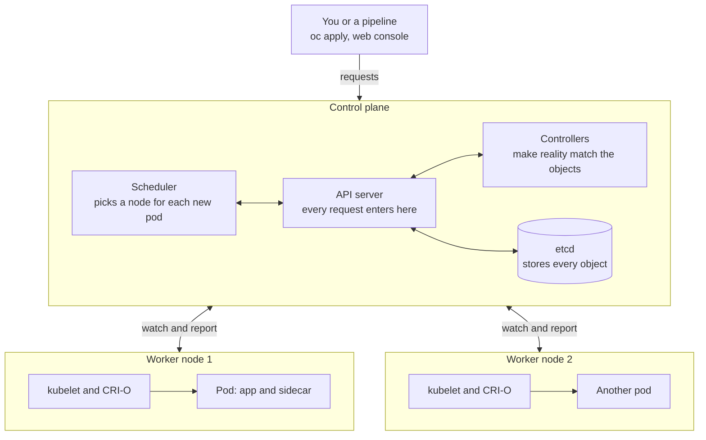
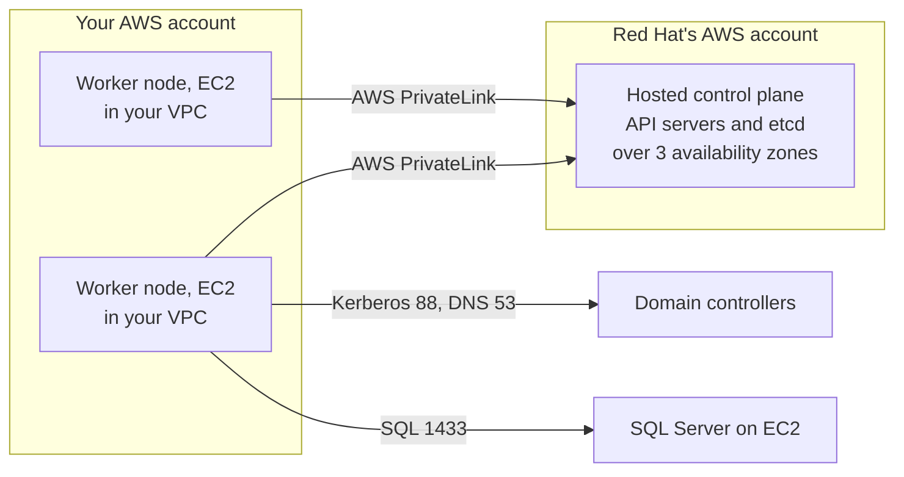

# Kubernetes, OpenShift and pods

The app and its Kerberos sidecar will run as a pod on an OpenShift cluster. This page explains those words from the beginning: containers, Kubernetes, pods, what OpenShift adds, and how ROSA HCP splits the work between Red Hat and you. It ends by following the pod in this design from `oc apply` to its first database login. Every abbreviation is spelled out in [00-abbreviations.md](00-abbreviations.md).

## Containers and images

An image is a packaged filesystem: an operating system base (for example Red Hat UBI, the Universal Base Image), your app's files, and the libraries they need, such as pyodbc and the ODBC driver. Images are kept in a registry and named with a tag, such as `registry.example.com/app:1.4`.

A container is a running copy of an image: one main process with its own view of the filesystem, the network and the process list. When the main process exits, the container stops. A container is not a virtual machine. All containers on a host share the host's Linux kernel, which keeps them apart (namespaces) and caps the CPU and memory each one may use (cgroups). That is why a container starts in about a second.

Containers are meant to do one job each. An image with your Python app should not also have to manage Kerberos, ship logs, or terminate TLS. Mixing jobs makes images larger, harder to patch, and harder to reason about. This is the reason for the sidecar in [07-sidecars.md](07-sidecars.md).

Running one container on your laptop takes one command (`podman run`). Running hundreds of them across many machines raises questions one command cannot answer: which machine has room, what happens when a container crashes or a machine dies, how containers find each other, and how they get their settings and passwords. Kubernetes answers those questions.

## Kubernetes: you describe what you want, it keeps it that way

Kubernetes is an open-source system that runs containers across a group of machines called a cluster. You do not tell it "start this container on machine 3". You give it a description of what you want, for example "one copy of this pod, with this keytab mounted, using at most 512 MiB of memory". Kubernetes stores that description, called the desired state, and keeps working to make the cluster match it. If the pod dies, it starts a new one. If you change the description, it changes the cluster. This compare-and-fix loop is called reconciliation, and nearly everything in Kubernetes works this way.

Each description is an object, usually written in YAML (a plain-text format). Every object has a kind (Pod, Deployment, Secret and so on), a name, and a `spec` that says what you want. Kubernetes adds a `status` that says what exists right now.

## Cluster architecture

A cluster has two parts: the control plane, which decides, and the worker nodes, which run your containers.

Control plane components ([Kubernetes: Components](https://kubernetes.io/docs/concepts/overview/components/)):

| Component | What it does |
| --- | --- |
| API server (`kube-apiserver`) | The front door. Every request goes through it: yours from `oc` or the web console, and those of the other components. It checks who is asking and what they may do before it saves anything |
| etcd | The cluster's database, a key-value store that holds every object, Secrets included |
| Scheduler (`kube-scheduler`) | Finds pods that have no node yet and assigns each one to a node with enough free CPU and memory that also meets any placement rules |
| Controller manager (`kube-controller-manager`) | Runs the controllers. Each controller watches one kind of object and acts when reality differs from it. The Deployment controller, for example, creates or removes pods until the count matches |

Worker node components:

| Component | What it does |
| --- | --- |
| kubelet | An agent on every node. It watches the API server for pods assigned to its node, asks the container runtime to start their containers, mounts their volumes, runs their health checks, and reports their status back |
| Container runtime | The program that starts and stops containers. OpenShift uses CRI-O |
| Network plugin | Gives every pod its own IP address and carries traffic between pods and out of the cluster. OpenShift uses OVN-Kubernetes |

The components coordinate by reading and writing objects through the API server. The scheduler, for example, never tells a kubelet to start a pod. It writes the chosen node's name onto the pod object, and the kubelet on that node notices.

## Pods

A pod is the smallest thing Kubernetes runs. Kubernetes never runs a bare container; it runs pods, and each pod holds one or more containers ([Kubernetes: Pods](https://kubernetes.io/docs/concepts/workloads/pods/)).

The containers in one pod share:

- The node. They are always placed together on the same worker node.
- The network. The pod gets one IP address, and its containers reach each other on `localhost`. Two containers in one pod cannot listen on the same port.
- Volumes. A volume is a folder defined for the whole pod. Each container decides whether to mount it, and at which path. This is how the sidecar hands the ticket to the app.
- The lifetime. They are created together and removed together.

Each container still has its own filesystem from its own image, its own processes, and its own environment variables. Files pass between containers only through a volume that both mount.

Pods are disposable. Kubernetes does not repair a broken pod or move it to another node; it creates a new, near-identical pod in its place ([Kubernetes: Pod lifecycle](https://kubernetes.io/docs/concepts/workloads/pods/pod-lifecycle/)). The new pod has a new name and a new IP address, and anything written inside the old containers is gone. For this design that is fine: the ticket cache is meant to be temporary, and the sidecar gets a fresh ticket when the new pod starts. Data that must survive belongs in a database, a volume backed by real storage, or a Secret.

The pod's IP address only means something inside the cluster. When a pod connects to a domain controller or to SQL Server, the traffic leaves with the worker node's IP address. [08-openshift-and-rosa-hcp.md](08-openshift-and-rosa-hcp.md) explains why that matters for firewalls.

### Inside a pod definition

| Field | What it holds | In this design |
| --- | --- | --- |
| `containers` | The main containers: image, command, environment variables, volume mounts, resource limits, health checks | The app |
| `initContainers` | Containers that run before the main ones. With `restartPolicy: Always`, an init container keeps running as a sidecar | The Kerberos sidecar |
| `volumes` | Folders the containers can mount: from a Secret, from a ConfigMap, an in-memory `emptyDir`, or real storage | Keytab, `krb5.conf`, ticket cache |
| `securityContext` | User ID, groups and Linux privileges. On OpenShift the SCC fills most of this in | Left to OpenShift, so both containers get the same UID |
| `serviceAccountName` | The Kubernetes identity the pod uses when it talks to the cluster | Not the AD account `svc-app` (see below) |
| `resources` | The CPU and memory a container asks for, and the most it may use | Small for the sidecar |

There are two different things called "service account" in this pack. A Kubernetes ServiceAccount is an identity inside the cluster, used when a pod calls the Kubernetes API or, with the AWS Secrets Manager CSI option, to get an AWS IAM role. The AD service account `CORP\svc-app` is an identity in Active Directory, used to log in to SQL Server. They are unrelated, and the Kerberos part of this design only involves the AD one.

### A pod's life

A pod moves through these phases ([Kubernetes: Pod lifecycle](https://kubernetes.io/docs/concepts/workloads/pods/pod-lifecycle/)):

| Phase | Meaning |
| --- | --- |
| `Pending` | Accepted by the cluster but not running yet: waiting for a node, pulling images, or running init containers |
| `Running` | Placed on a node, containers created, at least one running or restarting |
| `Succeeded` | All containers exited successfully and will not restart. Normal for a Job or an Airflow task pod |
| `Failed` | All containers stopped and at least one failed |
| `Unknown` | The cluster cannot reach the node to find out |

While a pod runs, the kubelet tests its containers with probes that you define:

- A startup probe asks whether the container has finished starting. The other probes wait until it passes. The sidecar uses `klist -s` as its startup probe, so the app starts only once a ticket exists.
- A liveness probe asks whether the container is stuck. After repeated failures the kubelet restarts that container.
- A readiness probe asks whether the pod should receive incoming traffic. It matters for pods behind a Service; the app in this design only makes outgoing connections.

When a container crashes, the kubelet restarts it inside the same pod, waiting longer between attempts each time (shown as `CrashLoopBackOff`). The pod keeps its name and IP address; only the container restarts.

### Who creates pods

You rarely create a pod by hand, because nothing would replace it if it died. A higher-level object creates pods for you:

| Object | Use | Example |
| --- | --- | --- |
| Deployment | Keep a set number of copies of a long-running pod, and replace them one at a time on upgrade | A service that runs all day, like the PoC app |
| Job | Run a pod until it finishes successfully, retrying on failure | A one-off data load |
| CronJob | Create a Job on a schedule | A nightly extract |

A Deployment keeps its pod count through a ReplicaSet, an object you rarely touch yourself. Airflow's KubernetesExecutor skips these and creates one pod per task. Each task pod has to reach `Succeeded` when the task ends, even though the sidecar was still running, and native sidecars make that possible.

## Other objects in this design

| Object | What it is | In this design |
| --- | --- | --- |
| Namespace (a project, in OpenShift) | A named area that groups objects and controls who may see or change them. Most object names only need to be unique inside one namespace | The PoC project |
| Secret | Sensitive data, stored in etcd and given to pods as files or environment variables | The keytab |
| ConfigMap | Non-sensitive settings, given to pods the same way | `krb5.conf` |
| `emptyDir` volume | An empty folder created for one pod and deleted with it. `medium: Memory` keeps it in RAM | The ticket cache |
| Service | A stable name and IP address in front of a changing set of pods, for incoming traffic | Not needed; the app only connects out |
| Route | OpenShift's way to expose a Service outside the cluster under a host name | Not needed |
| EgressIP | An OpenShift object that gives a project's outgoing traffic fixed source IP addresses | Optional; see [08-openshift-and-rosa-hcp.md](08-openshift-and-rosa-hcp.md) |

## What OpenShift adds to Kubernetes

OpenShift is Red Hat's Kubernetes distribution. Underneath it is Kubernetes, with the same API, objects and components described above. Red Hat adds:

- An operating system for the nodes. Nodes run Red Hat Enterprise Linux CoreOS (RHCOS), a minimal operating system that the cluster updates itself. CRI-O and the kubelet run directly on each node as system services, and almost everything else runs as pods managed by Operators ([OpenShift: Control plane architecture](https://docs.redhat.com/en/documentation/openshift_container_platform/4.19/html/architecture/control-plane)).
- Operators for the platform itself. An Operator is a controller that runs one piece of software: it installs it, configures it, upgrades it, and puts back any setting that drifts. Each part of OpenShift, such as DNS, networking, ingress, monitoring and etcd, has its own Operator. The Cluster Version Operator (CVO) keeps these cluster Operators at the right version, and Operator Lifecycle Manager (OLM) manages add-on Operators you install later. The DNS Operator mentioned elsewhere in this pack is the one that runs the cluster's DNS service.
- Projects. A project is a Kubernetes namespace with extra annotations, and it is how OpenShift controls what regular users can reach. Each project also gets its own range of user IDs, which is where a pod's assigned UID comes from.
- Stricter security by default. Security Context Constraints (SCCs) decide what a pod may do. The default, `restricted-v2`, runs containers as a non-root UID from the project's range with no extra Linux privileges. See [08-openshift-and-rosa-hcp.md](08-openshift-and-rosa-hcp.md).
- Networking pieces: OVN-Kubernetes as the network plugin, Routes for incoming traffic, and EgressIP for fixed outgoing addresses.
- Tools: a web console, and the `oc` command-line tool, which does everything `kubectl` does and adds OpenShift commands such as `oc new-project` and `oc rsh`.

## ROSA HCP: who runs which part

ROSA (Red Hat OpenShift Service on AWS) is OpenShift run as a managed service on AWS. Red Hat's site reliability engineers (SREs) install, patch and upgrade the cluster; you deploy and run your apps on it. With hosted control planes (HCP), the two halves of the cluster sit in different AWS accounts ([Red Hat: Introduction to ROSA](https://docs.redhat.com/en/documentation/red_hat_openshift_service_on_aws/4/html-single/introduction_to_rosa/index)):

- The control plane (API servers, etcd and the rest) runs in a Red Hat-owned AWS account, spread over three availability zones, with two API server instances and three etcd instances. You never see these machines.
- The worker nodes are EC2 instances in your AWS account, in your VPC's private subnets. They reach the control plane through an AWS PrivateLink endpoint. A cluster needs at least two worker nodes. Workers are grouped into machine pools; the nodes in one pool share an instance type and settings.

What the split means for this project:

- Your pods run on machines in your VPC, so their traffic to the domain controllers and SQL Server starts in your network and follows your routes and firewall rules.
- You cannot log in to the nodes or change their operating system. Everything Kerberos needs has to arrive with the pod: the tools in the image, `krb5.conf` from a ConfigMap, the keytab from a Secret.
- Red Hat's service definition limits what you may change at cluster level; [08-openshift-and-rosa-hcp.md](08-openshift-and-rosa-hcp.md) lists the parts that matter here.

## Following the Kerberos pod from start to finish

1. You run `oc apply -f deployment.yaml` in the PoC project. The API server checks, through RBAC (role-based access control), that you may create Deployments there, and saves the Deployment in etcd.
2. The Deployment controller sees a Deployment that wants one pod and has none, and through a ReplicaSet it creates a Pod object. As the pod is admitted, OpenShift applies the `restricted-v2` SCC and fills in a UID from the project's range. The pod is `Pending`, with no node yet.
3. The scheduler picks a worker node with enough free CPU and memory and writes the node's name onto the pod.
4. The kubelet on that node sees the new pod. CRI-O pulls both images. The kubelet sets up the volumes: the in-memory `emptyDir` for the ticket cache, the keytab Secret (mounted into the sidecar only), and the `krb5.conf` ConfigMap (mounted into both).
5. The sidecar starts first, because it is an init container. It runs `kinit` with the keytab and writes the TGT to the shared cache, and its startup probe (`klist -s`) passes.
6. The app container starts. Its first `pyodbc.connect` reads the TGT from the cache, gets a service ticket for SQL Server, and logs in. [02-kerberos.md](02-kerberos.md) follows that login step by step.
7. The pod is `Running`. Every hour the sidecar runs `kinit` again. If a container crashes, the kubelet restarts it inside the same pod. If the node dies, the Deployment controller creates a replacement pod on another node, which goes through steps 2 to 6 with an empty ticket cache.
8. When the pod is removed, for example during an upgrade, Kubernetes stops the app container first and the sidecar last. The in-memory volume is deleted with the pod, so no ticket stays behind on the node.

## Commands for looking around

| Command | Shows |
| --- | --- |
| `oc project <name>` | Switches to a project |
| `oc get pods` | The pods in the current project and their phase |
| `oc describe pod <pod>` | Node, IP address, volumes, the SCC applied, and recent events. The first thing to run when a pod stays `Pending` |
| `oc logs <pod> -c kerberos` | The log of one container in the pod, here the sidecar |
| `oc rsh -c app <pod>` | A shell inside the app container, for running `klist` |
| `oc get events --sort-by=.lastTimestamp` | Recent events in the project, newest last |
| `oc explain pod.spec` | Built-in reference for any field of an object |

## Where to go next

- [07-sidecars.md](07-sidecars.md) for the sidecar pattern and the Kerberos sidecar in detail.
- [08-openshift-and-rosa-hcp.md](08-openshift-and-rosa-hcp.md) for the OpenShift and ROSA rules that affect Kerberos.
- [Kubernetes: Cluster architecture](https://kubernetes.io/docs/concepts/architecture/), the official version of the architecture section above.
