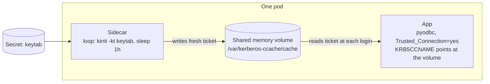

# Sidecars

This page explains the sidecar pattern and the Kerberos sidecar used in this design. It assumes you know what a container and a pod are; [06-kubernetes-openshift-and-pods.md](06-kubernetes-openshift-and-pods.md) covers both from the start. In short: a pod is a group of containers that run on the same node, share one IP address, and can share folders (volumes). Most pods hold one container. A pod holds more than one when the extra containers exist only to support the main one ([Kubernetes: Pods](https://kubernetes.io/docs/concepts/workloads/pods/)).

## Sidecar

A sidecar is a helper container that runs next to the main app container in the same pod, for the whole life of the pod, doing a supporting job the app should not do itself. The name comes from the sidecar on a motorbike, which is attached to the bike and travels with it but never steers.

Common examples:

- A log shipper that reads the app's log files from a shared volume and sends them to a central system.
- A proxy that handles TLS or retries for the app's network traffic.
- A config reloader that watches for changes and writes fresh config files for the app.
- A credential refresher that keeps a token or ticket up to date in a shared volume. This is the Kerberos sidecar.

In each example the sidecar and the app share a volume or `localhost`. The sidecar writes to it or reads from it, and the app does not need to know how the sidecar works.

## Init container

An init container runs to completion before the app containers start. If it fails, Kubernetes retries it and the app never starts. It is used for one-time setup: waiting for a dependency, preparing a file, or getting a first ticket.

## Native sidecar

For years, a "sidecar" was just a second entry in the pod's container list, and Kubernetes did not know it was a helper. That causes two problems:

- No start order. The app might start before the sidecar has written the first ticket.
- No stop order. In a pod that should finish (a Job, an Airflow task), the app exits but the sidecar keeps running, so the pod stays `Running`.

Kubernetes fixed this with native sidecars: an init container with `restartPolicy: Always`. It starts before the app containers, keeps running alongside them, and is stopped after they finish. A startup probe can hold the app back until the sidecar is ready. The feature is stable since Kubernetes 1.33 ([Kubernetes: Sidecar containers](https://kubernetes.io/docs/concepts/workloads/pods/sidecar-containers/)).

## Volumes used here

| Volume type | What it is | Used for |
| --- | --- | --- |
| `emptyDir` with `medium: Memory` | An empty directory created for the pod in RAM (tmpfs), deleted when the pod goes away | The shared ticket cache. In memory, so tickets never touch disk |
| Secret | Sensitive data stored by the cluster and mounted as files (also on tmpfs) | The keytab |
| ConfigMap | Non-sensitive data mounted as files | `krb5.conf` |

All containers in a pod can read and write the same files in an `emptyDir` ([Kubernetes: emptyDir](https://kubernetes.io/docs/reference/storage/volume-types/#emptydir)). Files in a memory-backed `emptyDir` count against the memory limit of the container that wrote them; a ticket cache is a few kilobytes.

## The Kerberos sidecar, put together



What each container knows:

- The sidecar knows the keytab, the principal and `krb5.conf`. It knows nothing about SQL Server or the app.
- The app knows `krb5.conf` and where the ticket cache is. It never sees the keytab, and it has no Kerberos code; pyodbc and the ODBC driver find the ticket through `KRB5CCNAME`.

Red Hat published this design in 2018, with apps that use the Microsoft ODBC driver as the motivating case. Its sidecar runs `kinit -k` every `PERIOD_SECONDS` (3600 by default) and writes the cache to `/dev/shm`, which the demo's OpenShift template backs with a memory-backed `emptyDir` ([Red Hat: Kerberos Sidecar Container](https://www.redhat.com/en/blog/kerberos-sidecar-container), [demo template](https://github.com/edseymour/kinit-sidecar/blob/master/openshift/example-client-deploy.yaml)). The Airflow Helm chart does the same with `airflow kerberos` as the loop.

## Why not put kinit in the app container?

You can, and stage 1 of the PoC does exactly that, because it is quicker. The sidecar is preferred beyond the PoC because:

- The keytab, which works like a password, stays out of the container that runs your app code and its dependencies.
- Ticket renewal does not depend on your app's startup script or process manager.
- The same sidecar image serves every app that needs Kerberos and is patched separately from them.

The cost is a second container per pod and a little more YAML.

## What a pod with a sidecar looks like

A trimmed sketch, for reading only. It shows where each piece goes, not a working manifest:

```yaml
spec:
  initContainers:
    - name: kerberos                # native sidecar: init container that keeps running
      restartPolicy: Always
      image: <ubi image with krb5-workstation>
      # runs: kinit -kt /keytab/svc-app.keytab svc-app@CORP.EXAMPLE.COM, then sleeps, in a loop
      env: [{name: KRB5CCNAME, value: FILE:/var/kerberos-ccache/cache}]
      startupProbe: {exec: {command: [klist, -s]}}
      volumeMounts: [keytab, krb5-conf, ccache]
  containers:
    - name: app
      image: <python + pyodbc + msodbcsql18>
      env: [{name: KRB5CCNAME, value: FILE:/var/kerberos-ccache/cache}]
      volumeMounts: [krb5-conf, ccache]   # no keytab here
  volumes:
    - {name: ccache, emptyDir: {medium: Memory}}
    - {name: keytab, secret: {secretName: svc-app-keytab}}
    - {name: krb5-conf, configMap: {name: krb5-conf}}
```

## Pitfalls specific to Kerberos sidecars

- Different user IDs. The ticket file is created with mode 0600, so a container running as another UID cannot read it. On OpenShift, do not set `runAsUser` on one container and not the other.
- The wrong cache type. Images based on RHEL default to `KEYRING:`. Set `KRB5CCNAME=FILE:...` in both containers.
- App starting first. Without an init container or a startup probe, the app's first connection fails with "No Kerberos credentials available".
- Pods that never finish. With a plain (non-native) sidecar, Jobs and Airflow tasks stay `Running`.

## Where to go next

- [08-openshift-and-rosa-hcp.md](08-openshift-and-rosa-hcp.md) for the OpenShift rules that affect all of this.
